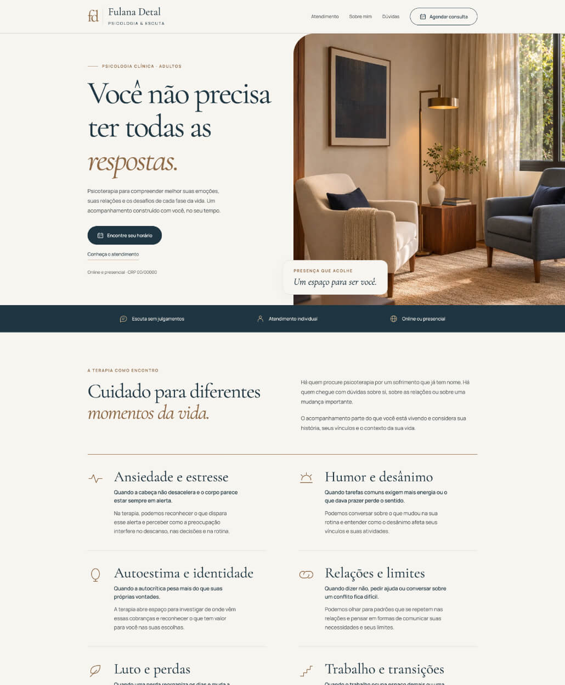

# Fulana Detal · Psicologia

Site de uma psicóloga clínica, com apresentação profissional, áreas de atendimento, agenda por disponibilidade e canais de contato.

Projeto de portfólio desenvolvido em HTML, CSS e JavaScript, com foco em acolhimento, acessibilidade e desempenho.

## Prévia

<table>
  <tr>
    <th>Desktop</th>
    <th>Mobile</th>
  </tr>
  <tr>
    <td valign="top"></td>
    <td valign="top"></td>
  </tr>
</table>

)

## Sobre o desenvolvimento

- **Sem frameworks:** HTML semântico, CSS e JavaScript puro, sem etapa de build.
- **Agenda interativa:** os horários são gerados a partir de uma grade semanal, com atalhos para os próximos dias de atendimento, validação do formulário e confirmação em um `<dialog>`.
- **Layout responsivo:** variáveis CSS para cores, espaçamentos e tipografia, com pontos de quebra pensados do desktop até telas pequenas.
- **Acessibilidade:** marcação com `aria-*`, navegação por teclado e respeito às preferências de movimento e transparência reduzidos.
- **Desempenho e SEO:** imagens em WebP, animações via `IntersectionObserver` em vez de eventos de rolagem, dados estruturados, `sitemap.xml` e `robots.txt`.
